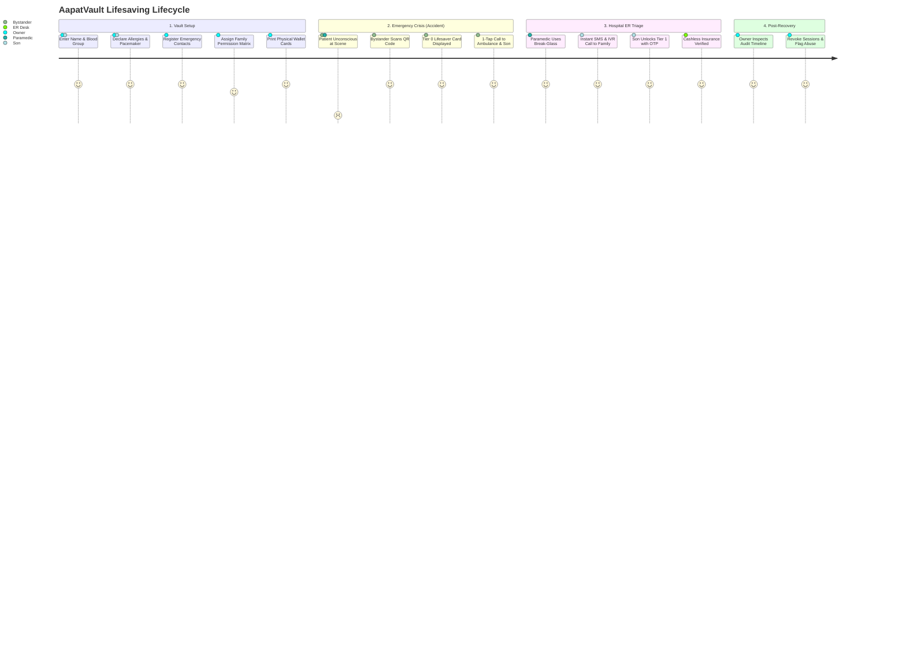
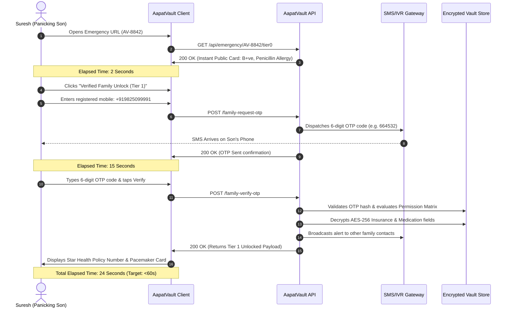

# Deliverable 2: End-to-End User Journeys

---

## Journey 1: Vault Setup (Owner Guided & Assisted Setup)

### Primary Actor: Ramesh Patel (Elderly Owner) & Suresh Patel (Son, Facilitator)
- **Goal**: Configure an active, encrypted emergency vault in **under 5 minutes** and generate physical wallet cards.

### Step-by-Step Flow:
1. **Entry & Assisted Mode Toggle**:
   - Suresh opens AapatVault on his smartphone and toggles *"Assisted Setup for Parent / Relative"*.
   - Chooses preferred regional language (**Gujarati / Hindi / English**).
2. **Step 1: Identity & Blood Group (30 seconds)**:
   - Enters father's name: *Ramesh Patel*, DOB: *1958-04-12*, Gender: *Male*.
   - Selects Blood Group: **B+ve** (high-contrast large selector).
   - Enters home village address (AES-256 encrypted).
3. **Step 2: Critical Medical Details (60 seconds)**:
   - Declares Allergies: *"Severe Penicillin Allergy (Anaphylaxis risk)"*.
   - Chronic Conditions: *"Type-2 Diabetes (prone to hypoglycemia), Hypertension"*.
   - Daily Medications: *"Metformin 500mg, Telmisartan 40mg, Aspirin 75mg"*.
   - Implants: *"St. Jude Dual-Chamber Pacemaker (2021) - MRI conditional"*.
   - Organ Donor: Checks *"Registered Donor"*.
   - Doctor: *Dr. K. Mehta (Cardiologist, +919825012345)*.
   - Preferred Hospital: *Shree Krishna Hospital, Karamsad*.
4. **Step 3: Emergency Contacts & Permissions (45 seconds)**:
   - Contact 1: *Suresh Patel (Son, Primary Guardian, +919825099991)*.
   - Contact 2: *Geeta Patel (Daughter, +919825099992)*.
   - The app automatically assigns full Tier 1 permission categories to both children.
5. **Step 4: Insurance & Voice Emergency Instructions (60 seconds)**:
   - Insurance Provider: *Star Health Senior Citizen*, Policy # *SH-8849-2048-01*, Helpline: *1800-425-2255*.
   - Emergency Instructions: Suresh records father speaking: *"If I am sweating or unconscious, give sugar immediately. Do not give penicillin. Call Suresh."*
   - Consent affirmation recorded in accordance with **India DPDP Act 2023**.
6. **Output Generation (15 seconds)**:
   - System outputs Vault ID: `AV-8842`.
   - Renders 1-tap **Print Wallet Card**, **Helmet Sticker**, and **Phone Lock Screen Wallpaper** with embedded offline QR code.
   - **Total Duration**: ~3.5 minutes.

---

## Journey 2: Family Emergency Access (Acute Moment of Need)

### Primary Actor: Suresh Patel (Son, Panicking)
- **Goal**: Access father's health insurance policy number and pacemaker specifications within 60 seconds at the hospital triage desk.

---

## Journey 3: Emergency Responder Break-Glass (Accident Scene)

### Primary Actor: EMT Anita Rao (108 Ambulance Paramedic)
- **Goal**: Identify drug allergies and pacemaker safety within 30 seconds before administering resuscitation drugs to an unconscious accident victim.

### Step-by-Step Flow:
1. **Scene Arrival & Scan (0 to 5 seconds)**:
   - EMT Anita spots the yellow AapatVault sticker on the victim's scooter helmet and wallet card in his pocket.
   - Points ambulance tablet camera at the QR code.
2. **Tier 0 Lifesaver Card Appears (5 to 8 seconds)**:
   - Zero login required.
   - Giant high-contrast red badge: **BLOOD GROUP: B+ve**.
   - Bright warning box: **CRITICAL ALLERGY: SEVERE PENICILLIN ANAPHYLAXIS RISK**.
   - Anita halts administration of penicillin-derived antibiotics, averting fatal shock.
3. **Triggering Tier 2 Break-Glass (8 to 20 seconds)**:
   - Anita needs to verify if the victim has a cardiac stent or pacemaker before defibrillation or MRI scanning.
   - Taps **"Emergency Responder Break-Glass (Tier 2)"**.
   - Input modal appears:
     - Name: *EMT Anita Rao*
     - Organization: *108 GVK EMRI Gujarat*
     - Badge #: *EMT-GUJ-904*
     - Reason: *Accident victim unconscious, trauma triage*
   - Anita taps **"Confirm & Unlock Tier 2"**.
4. **Immediate Decryption & Multi-Channel Alert (20 to 22 seconds)**:
   - System unlocks:
     - Pacemaker: *St. Jude Dual-Chamber Pacemaker (MRI conditional)*.
     - Medications: *Metformin, Telmisartan, Aspirin*.
     - Star Health insurance card.
   - Simultaneously, the backend triggers an automated SMS and automated voice IVR call to son Suresh and daughter Geeta with EMT Anita's name, organization, and hospital destination.
   - Session countdown timer starts (30 minutes remaining).
   - **Total Duration**: 22 seconds.

---

## Journey 4: Post-Incident Review & Access Revocation

### Primary Actor: Ramesh Patel (Recovered Owner)
- **Goal**: Review plain-language summary of who accessed his vault, verify legitimate use, and revoke active sessions.

### Step-by-Step Flow:
1. **Login & Notification Review**:
   - Ramesh recovers from hypoglycemia at the hospital and opens AapatVault with his PIN or assisted by his son.
   - Navigates to **"Incident Audit Log"**.
2. **Plain-Language Audit Inspection**:
   - System displays chronological cards formatted for layman readability:
     - Card 1: *"Public Lifesaver Card was viewed via QR / Lock Screen scan by an anonymous bystander at Highway Crossroad."*
     - Card 2: *"EMERGENCY BREAK-GLASS: EMT Anita Rao (108 GVK EMRI, Badge #EMT-GUJ-904) unlocked clinical emergency records for: 'Accident victim unconscious, trauma triage'."*
     - Card 3: *"Verified Family Member (Suresh Patel, Son) unlocked insurance and medications via SMS OTP."*
3. **Session Revocation & Flagging**:
   - Ramesh taps **"Revoke Access Immediately"** on any open session.
   - System terminates the session token, marks the log as `revoked_by: Vault Owner`, and locks all clinical records back to Tier 0.
   - If an unauthorized attempt had occurred, Ramesh could tap **"Report Fraud / Abuse"** which immediately alerts hospital authorities and blacklists the identifier.
