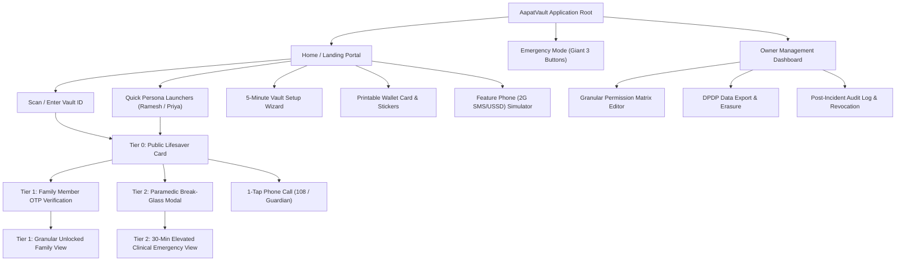

# Deliverable 3: Information Architecture and Screen Wireframe Specifications



---

## Screen-by-Screen Wireframe Specifications

### Screen 1: Home Portal & Fast Lookup
- **URL**: `/`
- **Purpose**: Welcomes users, facilitates rapid emergency entry, and provides 1-tap testing personas.
- **Key Elements**:
  - **Header Bar**: Brand logo, 7-language selector dropdown (`en`, `hi`, `kn`, `ta`, `te`, `bn`, `mr`), High-Contrast Mode toggle, Voice Assist button, and glowing red **"EMERGENCY MODE"** button.
  - **Hero Header**: High-urgency tagline *"When seconds matter, your vault speaks for you."*
  - **Direct Lookup Box**: Prominent input field supporting typed Vault IDs (`AV-8842`) or QR scan triggering.
  - **Persona Cards**:
    - *Ramesh Patel* (68M, Rural, B+ve, Pacemaker, Penicillin Allergy).
    - *Priya Sharma* (29F, Urban, O-ve, Sulfa Allergy, Inhaler in bag).
  - **Action Tiles**: "Create New Vault (Guided 5 Min)", "Print Physical Cards", "Feature Phone (2G USSD) Simulator".

---

### Screen 2: Emergency Mode Screen (Giant 3 Buttons)
- **Modal Trigger**: Red Header button or voice command *"Help"* / *"Emergency"*.
- **Purpose**: Zero-cognitive-load screen designed for panicking bystanders, non-literate users, or elderly users with shaking hands.
- **Wireframe Layout**:
  ```
  +--------------------------------------------------------------+
  |  [🚨 EMERGENCY MODE]                         (Voice Read) [X]|
  +--------------------------------------------------------------+
  |                                                              |
  |  +--------------------------------------------------------+  |
  |  |  [🚑 AMBULANCE ICON]                                   |  |
  |  |  CALL AMBULANCE 108                    [DIAL: 108]     |  |
  |  |  National Medical Emergency (Free)                     |  |
  |  +--------------------------------------------------------+  |
  |                                                              |
  |  +--------------------------------------------------------+  |
  |  |  [📞 PHONE ICON]                                       |  |
  |  |  CALL FAMILY                           [CALL NOW]      |  |
  |  |  Suresh Patel (Son, Primary Guardian)                  |  |
  |  +--------------------------------------------------------+  |
  |                                                              |
  |  +--------------------------------------------------------+  |
  |  |  [❤️ MEDICAL ICON]                                     |  |
  |  |  SHOW MEDICAL INFO                     [VIEW CARD]     |  |
  |  |  Blood Group, Allergies, Pacemaker & Lifesaver Card    |  |
  |  +--------------------------------------------------------+  |
  |                                                              |
  |  Other Emergency: Dial National Police/Disaster 112          |
  +--------------------------------------------------------------+
  ```
- **Accessibility**: Button heights >= 92px. High contrast bold typography. Automatic voice readout announces button functions in the selected native language.

---

### Screen 3: Tier 0 Public Lifesaver Card
- **URL**: `/emergency/:vaultId`
- **Purpose**: The instant landing screen from QR scan. Zero authentication. 100% leak-proof.
- **Wireframe Layout**:
  - **Header Ribbon**: Patient Name (*Ramesh Patel*), Age/Gender (*68M*), Vault ID, and massive white-on-red **Blood Group Badge** (`B+ve`).
  - **Allergy Alert Banner**: Amber box with warning icon: *"Severe Penicillin Allergy (Anaphylaxis shock risk)"*.
  - **Condition Tiles**: Chronic Illnesses (*Type-2 Diabetes, Hypertension*) & Organ Donor status (*Registered Donor*).
  - **Owner Emergency Instructions**: In owner's own words: *"If found sweating profusely or unconscious, give sugar candy immediately. Do NOT inject penicillin. Contact son Suresh."*
  - **Top 2 Contacts**: Ranked cards with direct 1-tap `tel:` call buttons.
  - **Bottom Elevation Actions**:
    - Slate Button: *"Verified Family Member (Tier 1) →"*
    - Red Button: *"⚡ Emergency Responder Break-Glass (Tier 2)"*

---

### Screen 4: Family Member OTP Unlock Modal
- **Purpose**: Verifies guardian phone number to unlock Tier 1 permissions.
- **Wireframe Layout**:
  - Step A: Phone Number entry with hint *"Must match registered family guardian phone"*.
  - Step B: 6-Digit SMS OTP input box.
  - Development / Panic Benchmark feature: **"Demo OTP Auto-Fill"** chip allowing instant testing without external SMS delays.
  - Evaluates pre-configured permission matrix upon verification.

---

### Screen 5: Emergency Responder Break-Glass Modal & Elevated View
- **Purpose**: Fast 2-second clinical override with mandatory accountability.
- **Wireframe Layout**:
  - Disclosure Banner: Explains speed vs security trade-off and warns of immediate SMS & IVR phone broadcast to registered family.
  - Input Fields: Responder Name, Hospital / Ambulance Organization, Badge / EMT ID, Reason.
  - Execute Button: *"CONFIRM & UNLOCK TIER 2 CLINICAL DATA"*.
  - **Elevated View**:
    - Floating banner with **30:00 Countdown Timer**.
    - Full medications schedule (*Metformin 500mg, Telmisartan 40mg, Aspirin 75mg*).
    - Implants specifications (*St. Jude Pacemaker - MRI conditional*).
    - Cashless Insurance card (*Star Health Senior Citizen #SH-8849-2048-01, Helpline 1800-425-2255*).
    - Attached diagnostic PDFs (2D-Echo report, Pacemaker card).
    - 1-Tap **"Lock & Revoke Access"** killswitch.

---

### Screen 6: 5-Minute Guided Vault Setup Wizard
- **URL**: `/setup`
- **Purpose**: Onboarding wizard with assisted mode for elderly parents.
- **Wireframe Layout**:
  - Top Progress Stepper (Steps 1 to 4).
  - Assisted mode checkbox: *"Are you setting this up on behalf of an elderly parent?"*
  - Pre-fill buttons: *"Pre-fill Elder (Ramesh)"*, *"Pre-fill Urban (Priya)"*.
  - Step 1: Personal & Blood Group.
  - Step 2: Allergies, Conditions, Medications, Implants, Doctor, Hospital.
  - Step 3: Emergency Contacts (Ranked 1 and 2).
  - Step 4: Health Insurance & Emergency Instructions (voice / text).
  - Finishes with instant generation of physical printable assets.

---

### Screen 7: Owner Management Dashboard
- **URL**: `/dashboard`
- **Purpose**: Owner controls permissions matrix, updates clinical records, exports data.
- **Wireframe Layout**:
  - Summary stats (Allergies, Insurance, Contacts count, Document count).
  - **Family Permissions Matrix Manager**:
    - Displays authorized family members.
    - Checkboxes for granular categories: `medical_basics`, `medications`, `doctor_contacts`, `insurance`, `documents`, `home_address`.
    - Revoke button per family member.
  - **DPDP Act 2023 Compliance Panel**:
    - Button: *"Right to Portability (Export JSON Dump)"*.
    - Button: *"Right to Erasure (Permanently Delete All Data)"*.

---

### Screen 8: Incident Audit Log & Revocation Screen
- **URL**: `/audit`
- **Purpose**: Post-incident forensic timeline in plain language.
- **Wireframe Layout**:
  - Status Badge: *"Tamper-Evident Ledger Active"*.
  - Chronological Cards showing exact actor, organization, badge, IP, timestamp, and location.
  - Active Session Indicators with countdown timer.
  - Red Button: *"Revoke Access Immediately"*.
  - Dispatched SMS and automated IVR phone broadcast log viewer.

---

### Screen 9: Printable Wallet Card & Lock Screen Generator
- **Modal Trigger**: Header "Print Card" button.
- **Renders 3 Physical Formats**:
  1. **Wallet Card Front & Back**: Standard ISO credit card dimensions, high-contrast red/white layout with QR code, blood group, allergies, contacts.
  2. **Helmet / Vehicle Sticker**: Circular high-contrast warning sticker for scooter/motorcycle helmets.
  3. **Phone Lock Screen Wallpaper**: Phone mockup displaying QR code overlay for easy lock screen download.
  4. Print button invoking `window.print()` with clean print-only styles.

---

### Screen 10: 2G / Feature Phone SMS / USSD Fallback Screen
- **Modal Trigger**: Header "Feature Phone" button.
- **Purpose**: Simulates non-internet basic keypad phone interactions.
- **Renders**:
  - Green monochrome retro LCD phone screen.
  - USSD dialer (`*999*AV-8842#`) or SMS query (`HELP AV-8842` to 108).
  - Displays instant response with blood group, penicillin allergy, and contacts.
  - Voice Read Aloud button for non-literate callers.
