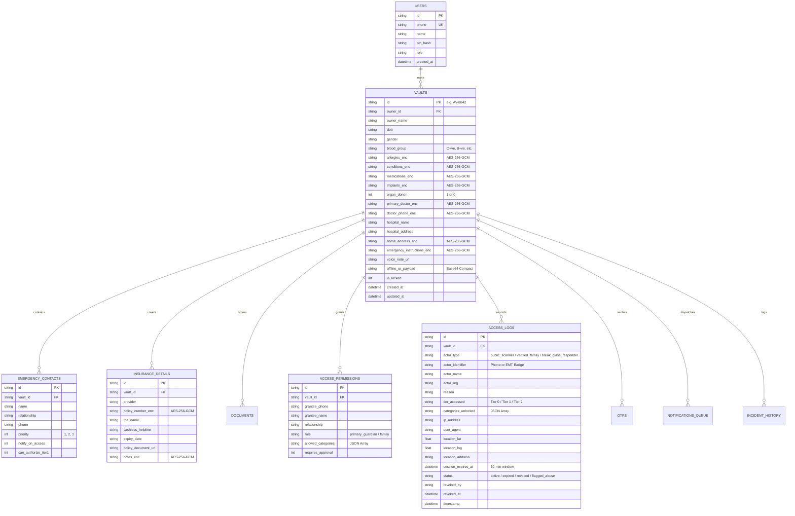

# Deliverable 4: Data Model and Access-Control Rules



---

## Access-Control Matrix (Tier & Permission Policy)

| Data Category | Tier 0: Public Lifesaver (Bystander/QR) | Tier 1: Verified Family (SMS OTP) | Tier 2: Break-Glass Responder (EMT/ER) | Vault Owner (PIN/Biometric) |
|---|:---:|:---:|:---:|:---:|
| **Patient Full Name** | Visible | Visible | Visible | Visible |
| **Blood Group** | **Visible (Plain)** | Visible | Visible | Visible |
| **Critical Allergies (Anaphylaxis Risk)** | **Visible (Decrypted)** | Visible | Visible | Visible |
| **Immediate Lifesaving Conditions** | **Visible (Decrypted)** | Visible | Visible | Visible |
| **Organ Donor Status** | Visible | Visible | Visible | Visible |
| **Emergency Contacts (Top 2)** | Visible with `tel:` links | Visible | Visible | Visible |
| **All Emergency Contacts (Ranked)** | Masked (Top 2 only) | **Visible** | Visible | Visible |
| **Emergency Instructions (Summary)** | Visible | Visible | Visible | Visible |
| **Full Daily Medications & Dosages** | ❌ **DENIED / MASKED** | **Conditional (Matrix)** | **Visible (Clinical)** | Visible |
| **Implants & Pacemaker Details** | ❌ **DENIED / MASKED** | **Conditional (Matrix)** | **Visible (MRI Safety)** | Visible |
| **Doctor Phone & Contacts** | ❌ **DENIED / MASKED** | **Conditional (Matrix)** | **Visible** | Visible |
| **Health Insurance Policy Number & TPA** | ❌ **DENIED / MASKED** | **Conditional (Matrix)** | **Visible (Cashless)** | Visible |
| **Medical Documents (Rx, Echo, Lab Scans)**| ❌ **DENIED / MASKED** | **Conditional (Matrix)** | **Visible (Medical Only)**| Visible |
| **Home Address & Residence Location** | ❌ **DENIED / MASKED** | **Conditional (Matrix)** | ❌ **DENIED / MASKED** | Visible |
| **Legal & Non-Clinical Documents** | ❌ **DENIED / MASKED** | **Conditional (Matrix)** | ❌ **DENIED / MASKED** | Visible |
| **Incident Audit Logs & Revocation** | ❌ **DENIED** | ❌ **DENIED** | ❌ **DENIED** | **Full Admin Control** |

---

## Architectural Principles & Security Enforcement

### 1. Strict Deny-by-Default
Any data field or category that is not explicitly whitelisted for a tier or authorized family member is automatically purged before transmission to the client. The server-side sanitizer (`accessControl.js`) operates at the database query layer, ensuring sensitive ciphertext is never even decrypted if the requester's permission mask lacks the category.

### 2. Least-Privilege Granular Slicing
In Tier 1, each family member is granted an independent category array:
```json
[
  "medical_basics",
  "medications",
  "doctor_contacts",
  "insurance",
  "documents",
  "home_address",
  "emergency_instructions",
  "incident_history"
]
```
For example, an owner may grant their son full access including `home_address` and `insurance`, but grant a trusted neighbor only `medical_basics` and `emergency_instructions`.

### 3. Field-Level AES-256-GCM Encryption
Sensitive personal and clinical data at rest are encrypted with **AES-256 in Galois/Counter Mode (GCM)**:
- **IV**: 12-byte cryptographically secure random bytes per field.
- **Auth Tag**: 16-byte authentication tag guaranteeing integrity and tamper detection.
- **Payload Format**: `enc:v1:<base64-iv>:<base64-tag>:<base64-ciphertext>`.
- **Key Separation**: The master encryption key is isolated from database backups and application storage.
