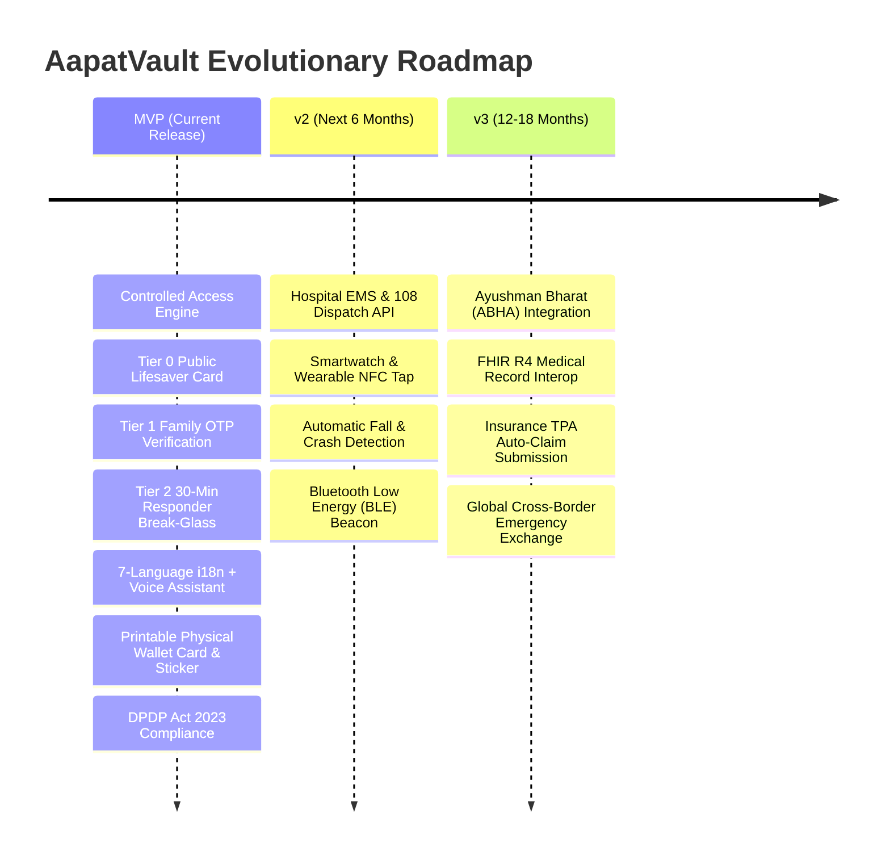

# Deliverable 8: Strategic Product Roadmap (MVP, v2, v3)

---

## Phase 1: MVP (Delivered & Verified)
- **Controlled Access Engine**: Tier 0 Public Lifesaver Card, Tier 1 Verified Family Matrix, Tier 2 Break-Glass with 30-minute auto-expiry.
- **Guided Onboarding**: Under-5-minute setup with assisted mode for elderly parents.
- **Accessibility & Language**:
  - Voice-First: Speak to navigate, voice-read screens, voice-record instructions.
  - Multi-Language: English, Hindi, Kannada, Tamil, Telugu, Bengali, Marathi.
  - High-Contrast Mode & Giant Touch Targets (92px).
- **Offline Resilience**: Offline QR base64 encoding and PWA Service Worker caching.
- **Feature Phone Fallback**: 2G SMS / USSD query simulator (`*999*VAULT#` and `HELP VAULT`).
- **Physical Assets**: Generator for Printable Wallet Cards, Helmet Stickers, and Phone Lock Screen Wallpapers.
- **Accountability**: Immutable audit logs, plain-language summaries, 1-tap revocation killswitch.
- **Compliance**: Field-level AES-256-GCM encryption, India DPDP Act 2023 data export and right-to-erasure.

---

## Phase 2: v2 (Hospital Dispatch, Wearables & BLE Beacons)
- **108 / 112 National CAD (Computer Aided Dispatch) Integration**:
  - Direct webhook integration into state emergency dispatch systems (GVK EMRI, dial 108/112).
  - When an ambulance is dispatched to an accident GPS coordinate, the nearest AapatVault profile within 100 meters is queued for the paramedic upon arrival.
- **Smartwatch & Wearable Complications (Wear OS / Apple Watch)**:
  - 1-Tap NFC tap on wearable watch to broadcast Tier 0 lifesaver data directly to paramedic rugged tablets.
  - Automatic fall detection and car crash detection beaconing: triggers an emergency ping to family if the user is unresponsive for 60 seconds after severe impact.
- **Bluetooth Low Energy (BLE) Eddystone Beaconing**:
  - Embedded BLE beacon mode in the mobile app, broadcasting an encrypted ephemeral beacon during active panic mode.
- **Biometric WebAuthn (Passkeys / Fingerprint)**:
  - FIDO2 / WebAuthn biometric unlock for Tier 1 family members who have the app installed, replacing SMS OTP with instantaneous 1-second biometric authentication.

---

## Phase 3: v3 (Ayushman Bharat Digital Mission & Global Interop)
- **ABDM / ABHA National Health ID Linkage**:
  - Link citizen 14-digit ABHA ID (Ayushman Bharat Health Account) to AapatVault.
  - Seamless pull of verified hospital discharge summaries, immunizations, and diagnostic reports via the ABDM Gateway (M1, M2, M3 milestones).
  - Integration with Pradhan Mantri Jan Arogya Yojana (PMJAY) for cashless government health insurance pre-authorization at empaneled hospitals.
- **FHIR R4 Diagnostic Standardization**:
  - Convert allergy, condition, and medication payloads into HL7 FHIR (Fast Healthcare Interoperability Resources) JSON objects, allowing automated ingestion by major Hospital Information Systems (HIS) including Epic, Cerner, and Indian Hospital HMIS.
- **Automated Insurance TPA Cashless Claim Filing**:
  - 1-Tap digital submission of emergency admission intimation to health insurance Third Party Administrators (TPAs) within the mandatory 24-hour window, eliminating claim rejection due to delayed notification.
- **Global Cross-Border Travel Health Vault**:
  - Multi-currency travel insurance integration with international SOS networks for citizens traveling abroad.
